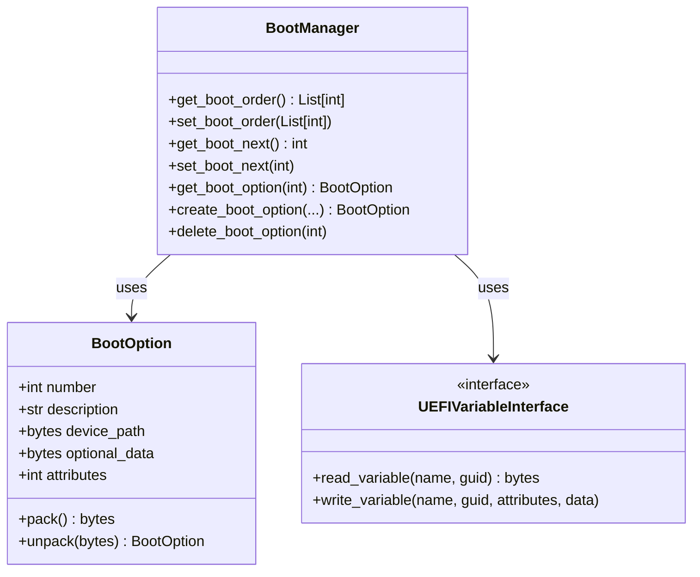
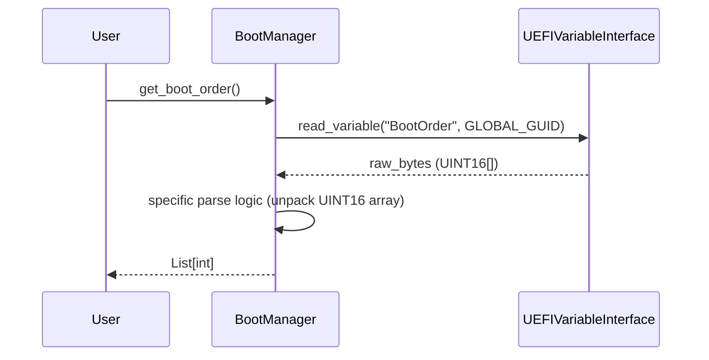
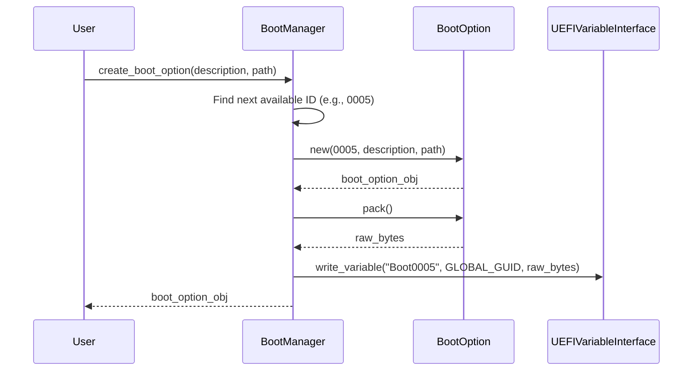

# Boot Management Design

## System Architecture

The Boot Management feature is designed as a module within the `automojo.sysman.uefi` package. It provides a high-level Python API to interact with UEFI variables related to boot configuration (`BootOrder`, `BootNext`, `Boot####`).

### Component Diagram

### Key Components

1.  **`BootManager`**: The primary entry point for consumers. It orchestrates reading/writing variables using the `UEFIVariableInterface` and parsing/serializing data using `BootOption`.
2.  **`BootOption`**: A data class responsible for representing a single boot entry (`Boot####`). It handles the binary format defined by the UEFI specification (EFI_LOAD_OPTION).
3.  **`UEFIVariableInterface`**: An abstraction layer for the OS-specific mechanism to access UEFI variables (e.g., Linux efivarfs, Windows GetFirmwareEnvironmentVariable).

## Sequence Diagrams

### Reading Boot Order

### Creating a New Boot Option

## Data Structures

### `Boot####` Variable Format (EFI_LOAD_OPTION)

| Field | Type | Description |
| :--- | :--- | :--- |
| Attributes | UINT32 | Bitmask (Active, Hidden, etc.) |
| FilePathListLength | UINT16 | Length of the device path in bytes |
| Description | CHAR16[] | Null-terminated string (UCS-2) |
| FilePathList | EFI_DEVICE_PATH_PROTOCOL[] | The device path structure |
| OptionalData | UINT8[] | Remaining bytes |

### `BootOrder` Variable Format

Array of `UINT16` values representing the BootOption numbers.

## Error Handling Strategy

*   **`UEFIVariableError`**: Raised when the underlying OS call fails (e.g., permission denied, variable not found).
    *   *Mitigation*: Ensure user has appropriate privileges (root/admin). The library should check this or handle `EACCES`/`EPERM` gracefully.
*   **`InvalidBootOptionError`**: Raised when parsing `Boot####` data fails (e.g., length mismatch, invalid format).
    *   *Mitigation*: Validate lengths before parsing. Log warning and skip malformed entries during enumeration.

## Testing Strategy

1.  **Unit Tests**:
    *   Mock `UEFIVariableInterface` to simulate reading/writing variables without touching real hardware.
    *   Test `BootOption.pack()` and `BootOption.unpack()` with known binary vectors (captured from real systems).
    *   Test `BootManager` logic (e.g., finding free IDs, reordering lists).

2.  **Integration Tests**:
    *   Run on a virtual machine (e.g., QEMU/KVM with OVMF) to verify interaction with a real UEFI implementation.
    *   *Caution*: Modification of `BootOrder` on a real machine can render it unbootable. Integration tests should be careful or run in a safe environment (e.g., only modifying a test variable or restoring state immediately).
